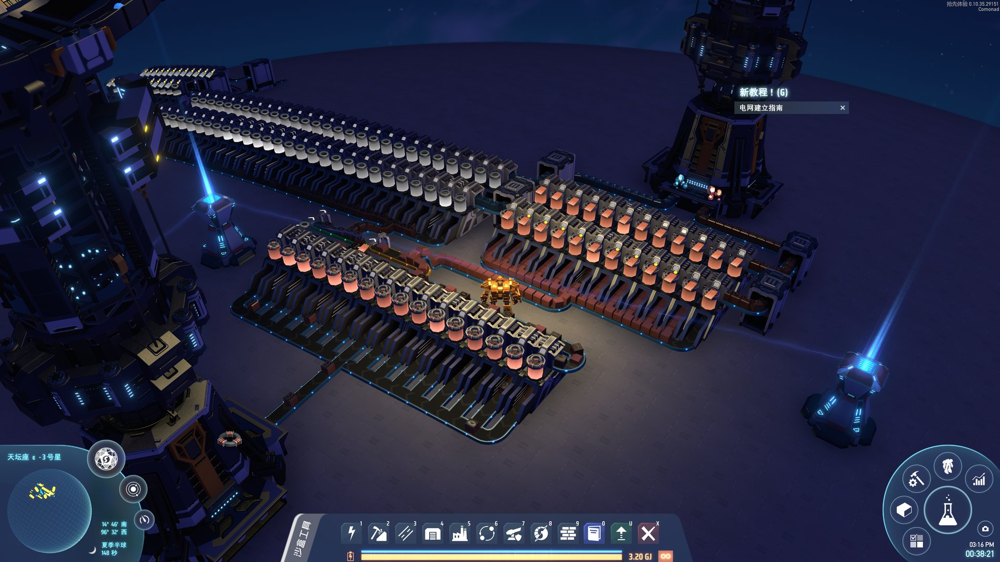

# Spray Factory / 喷涂工厂

使用喷涂机作为万能工厂，享受无需分拣器的工厂设计，并处理混入混出所带来的全新挑战。

## 添加内容

- 新建筑：喷涂工厂。上层传送带提供配方原料，下层贯穿传送带仅接收产物。
- 支持最多 6 种原料和 6 种产物的配方，输入与输出区域随配方数量自动换行。
- 支持原料的增产效果，可选择额外产出或生产加速。
- 产物按物流运输站的输出堆叠科技层数攒满后出货，多种产物轮流输出。

## 使用说明

- 随一级传送带解锁。制造需要 `4 铁块 + 2 齿轮 + 2 电路板`，基础制造时间 3 秒。
- 打开工厂窗口，点击齿轮选择配方，再从上层入口送入混带原料。
- 传送带自动进料只补到 2 轮配方用量。手动放入和 Ctrl 点击补料可缓存更多原料：一般配方 20 轮，熔炼配方 50 轮。
- 下层传送带可以完整贯穿建筑，不接收原料；请为混合产物预留输出空间。
- 工作功耗 300 kW，待机功耗约 10 kW。
- 建造菜单自动寻找空位；安装 BuildBarTool 时优先使用上排空位。

## 兼容性

- 已在游戏 0.10.35.29151、CommonAPI 1.6.7 环境下进行基础运行验证。
- 已通过堆叠增强与 OrbitalRing 1.0.20 的组合运行检查，支持堆叠增强的 8 层输出。
- OrbitalRing 的原生工厂模块和轨道环全局生产加成暂未接入。

## 问题反馈

如果遇到报错、显示异常或生产问题，请在 [GitHub](https://github.com/komonad/spray-factory) 提交 issue，并附上：

- 问题描述
- 游戏版本
- mod 版本
- 已安装 mod 列表
- `BepInEx/LogOutput.log`

## English

Turn the spray coater into a universal factory. Build production lines without sorters and take on the challenges of mixed inputs and outputs.

## Features

- New building: Spray Factory. The upper belt supplies recipe ingredients; the continuous lower belt receives products only.
- Supports recipes with up to 6 ingredients and 6 products. Input and output slots wrap into additional rows as needed.
- Supports proliferated ingredients, with a choice of extra products or production speedup.
- Accumulates full output stacks according to logistics station output stacking technology. Multiple products take turns entering the output belt.

## Usage

- Unlocked alongside Conveyor Belt Mk.I. Craft one factory from `4 Iron Ingots + 2 Gears + 2 Circuit Boards` in 3 seconds.
- Open the factory window, click the gear to choose a recipe, and supply mixed ingredients through the upper input.
- Belt input fills only 2 recipe batches. Manual insertion and Ctrl-click transfers can fill a larger buffer: 20 batches for most recipes, or 50 for smelting.
- The lower belt runs continuously through the building and does not accept ingredients. Leave room for mixed products on the output belt.
- Working power: 300 kW. Idle power: approximately 10 kW.
- Automatically selects a free build-menu slot, preferring the upper row when BuildBarTool is installed.

## Compatibility

- Basic runtime checks cover game 0.10.35.29151 and CommonAPI 1.6.7.
- Combined runtime checks pass with Stacking Enhancement and OrbitalRing 1.0.20, including 8-layer output stacks from Stacking Enhancement.
- OrbitalRing's native factory modules and orbital ring global production bonuses are not integrated.

## Feedback

If you run into errors, visual issues or production problems, please open an issue on [GitHub](https://github.com/komonad/spray-factory) and include:

- A description of the problem
- Game version
- Mod version
- Installed mod list
- `BepInEx/LogOutput.log`
